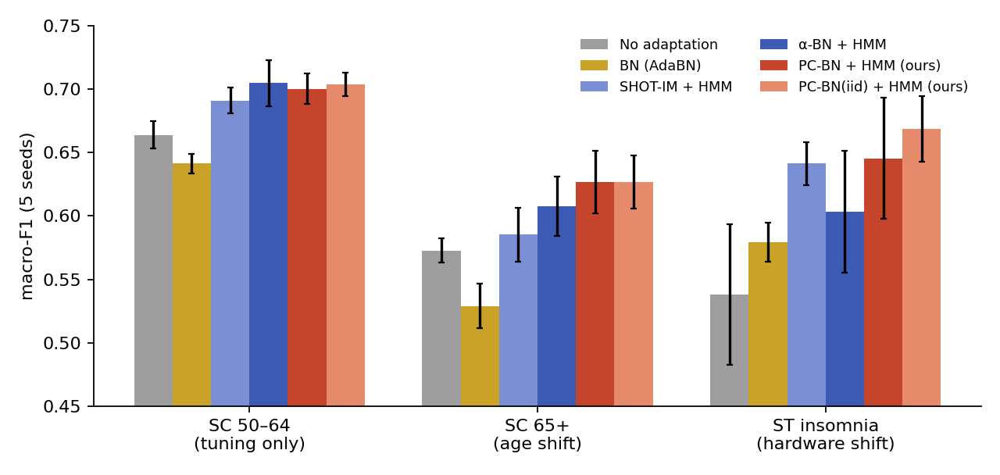
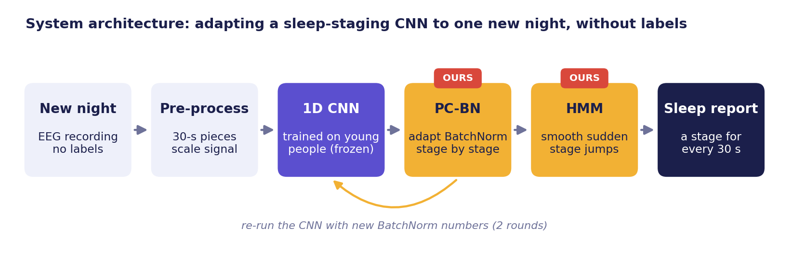

# PC-BN: Prior-Corrected BatchNorm for Sleep Staging on New People

A sleep-staging AI is trained on young adults and then has to label a **new person's night**,
with **no labels** and **no retraining**. The standard test-time fix (re-computing BatchNorm
statistics, "AdaBN") makes the model **worse than doing nothing** on elderly sleepers. **PC-BN**
is a simple fix for this, and combined with an HMM smoother it gives the best results of
12 methods tested.

| | No adaptation | AdaBN (popular) | **PC-BN + HMM (ours)** |
|---|---|---|---|
| People aged 65+ | 0.573 | 0.529 ❌ | **0.627** |
| Insomnia, other machine | 0.538 | 0.580 | **0.645** |
| **Average of both** | 0.555 | 0.554 | **0.636** |

<sub>Pooled macro-F1 (0 to 1, higher is better), mean of 5 independently trained models.</sub>



---

## 1. Problem statement

Sleep staging means labelling every 30-second piece of an overnight EEG as **Awake, N1, N2,
N3 (deep sleep) or REM**. A model trained on one group of people drops a lot on new people,
from about 0.73 to about 0.55 macro-F1 here. New people differ in two ways:

1. **A different recording machine** (covariate shift): the signal itself looks different.
2. **A different way of sleeping** (label shift): people over 65 have about **3× less deep
   sleep** and **2× more awake time**.

The usual unlabeled fix, **AdaBN**, re-computes BatchNorm statistics over the whole night.
Those statistics are a mix of all stages, so AdaBN **cannot tell "different machine" apart from
"less deep sleep"**. It "corrects" the elderly nights that needed no correction: macro-F1
falls from 0.573 to 0.529 and deep-sleep F1 from 0.66 to 0.52. TENT and SHOT, built on it,
fail the same way.

**Goal:** adapt to each new night so that machine differences are corrected but natural
sleep differences are left alone, with no labels, no retraining and no access to the
training data.

## 2. Our method: PC-BN

PC-BN looks at **each sleep stage separately** instead of the whole night mixed together:

1. **First guess.** The model labels every piece of the new night (soft labels).
2. **Per-stage statistics.** For every BatchNorm layer, compute what *each stage* looks like in
   this night (rare stages are shrunk toward the night mean, τ = 20).
3. **Re-mix with the training stage mix.** Combine the per-stage statistics using the
   **training group's** stage proportions, not the new person's.
4. **Repeat** once more with the improved guess (2 rounds).

Result: if every stage looks normal and there is just less deep sleep (an older person), the
statistics come out **unchanged**. If every stage looks different (another machine), they are
**corrected**. There are no gradient steps and no extra parameters.

Then an **HMM** with the training group's stage-to-stage transition matrix smooths the
predicted sequence and removes random one-epoch flips (the HMM idea itself is known, see
OATTA; we use it as a component).

## 3. System architecture



**Model (`models/sleepnet.py`):** a small 1D CNN (~332k parameters) that reads one 30-second
piece (3000 samples at 100 Hz) and outputs 5 stage scores.

```
Input (1 × 3000)
 → Conv(64, k=50, stride 6) + BatchNorm + ReLU → MaxPool(8) → Dropout
 → [Conv(128, k=8) + BatchNorm + ReLU] × 3      → MaxPool(4)
 → Global average pool (128) → Dropout → Linear → 5 stages (W, N1, N2, N3, REM)
```

It deliberately sees a **single epoch without context**, so any benefit from temporal order
comes from the adaptation and decoding methods being compared.

## 4. Dataset

[Sleep-EDF Expanded](https://physionet.org/content/sleep-edfx/1.0.0/) (PhysioNet, open
access), single-channel **Fpz-Cz EEG at 100 Hz**, 30-s epochs, AASM stages (R&K 3+4 → N3),
with 30 min of wake kept around the sleep period. **139 nights, 168,107 epochs.**

| Group | Nights | Role | Deep sleep (N3) share |
|---|---|---|---|
| SC, age 25–34 (20 people) | 39 | **training** (14/3/3 people train/val/test, new split per seed) | 13.5 % |
| SC, age 50–64 | 43 | **tuning only** | 5.2 % |
| SC, age 65+ | 35 | **held-out test** (mainly a sleep-pattern shift) | 4.3 % |
| ST insomnia, hospital telemetry | 22 | **held-out test** (mainly a machine shift) | 14.8 % |

No person appears in two groups. Each test night is adapted on its own, and the model is reset
between nights.

## 5. Results

Held-out mean pooled macro-F1 (SC 65+ and ST), 5 seeds:

| Method | Score |
|---|---|
| AdaBN (night BN) | 0.554 |
| No adaptation | 0.555 |
| TENT | 0.555 |
| SHOT-IM | 0.556 |
| Uniform balanced BN (TRIBE-style) | 0.575 |
| **PC-BN** | 0.597 |
| α-BN | 0.598 |
| BN + HMM | 0.606 |
| SHOT-IM + HMM (best existing) | 0.613 |
| **PC-BN + HMM** | **0.636** |
| **PC-BN(iid) + HMM** | **0.648** |

Key paired Wilcoxon tests over nights (per-night macro-F1 points):

* **PC-BN vs AdaBN on 65+:** +6.0, p = 2e-8 (better on 33 of 35 nights)
* **PC-BN + HMM vs no adaptation:** better on every group (p ≤ 0.021)
* **PC-BN vs uniform balanced BN on 65+:** +2.8, p = 5e-7

**Honest caveats:** PC-BN *alone* vs no adaptation on the elderly is +3.2 but not significant
(p = 0.084), so the clear gain needs the HMM. The `iid` variant was an ablation that did
as well or better, and choosing it afterwards would be post-hoc, so both are reported. Deep
sleep is not fully recovered on the elderly. Full tables: [`outputs/sleep_summary.md`](outputs/sleep_summary.md).
Full write-up with negative results and the code audit: **[REPORT.md](REPORT.md)**.

## 6. Repository layout

```
models/sleepnet.py     the 1D CNN
train_sleep.py         trains the CNN on young people (one run per seed)
tta/methods.py         all adaptation methods: AdaBN, TENT, SHOT-IM, α-BN, ... and PC-BN (balanced_bn)
tta/hmm.py             HMM decoders (source transitions, re-fitted, dwell-only, EM prior)
study_sleep_tta.py     main experiment: tuning + every method × decoder, one night at a time
study_dwell.py         label-only check of how much the stage dynamics shift
summarize_sleep.py     result tables + paired Wilcoxon tests
plot_sleep.py          results figure
eval/sleep_metrics.py  macro-F1, kappa, per-stage F1
data/sleepedf.py       downloads Sleep-EDF and converts each night to a small .npz
data/sleep.py          loads nights, groups them, splits, transition counts
common.py              seeding + JSON helpers
demo.py                quick live demo (~20 s on a GPU)
run_sleep_all.sh       whole study in one command (~2 h on an RTX 3060)
outputs/               5 trained models (sleep_s0..s4/model.pt), tuned settings, all results
figures/               results figure
PC-BN_Sleep_TTA.pptx   9-slide presentation
PC-BN_Final_Report.docx  written report (same content as REPORT.md)
RUN_DEMO.md            step-by-step guide for running the demo live
```

## 7. How to run

```bash
git clone https://github.com/2005lakshya/PC-BN-Sleep-TTA.git
cd PC-BN-Sleep-TTA
pip install -r requirements.txt

# 1. get the data (~6 GB download, ~1 GB kept; not stored in this repo)
python -m data.sleepedf --cache data/sleep_cache

# 2. quick demo with the included trained models (~20 s on GPU, ~10 min on CPU)
python demo.py                  # 35 nights of people aged 65+
python demo.py --target ST      # 22 insomnia nights
python demo.py --cpu            # force CPU
```

Expected demo output (seed 0, ages 65+):

```
method                  macro-F1   kappa   N3 F1
No adaptation              0.566   0.513   0.655
BN (AdaBN)                 0.558   0.518   0.500
PC-BN (ours)               0.619   0.609   0.570
BN + HMM                   0.617   0.566   0.527
PC-BN + HMM (ours)         0.634   0.610   0.566
PC-BN(iid) + HMM           0.644   0.615   0.547
```

Full reproduction (needs a GPU):

```bash
for s in 0 1 2 3 4; do python train_sleep.py --seed $s; done
python study_dwell.py
bash run_sleep_all.sh           # -> outputs/sleep_summary.md, figures/sleep_results.png
```

## 8. Limitations and next steps

* One dataset and 5 seeds; the insomnia group has only 22 nights.
* Single-epoch CNN; sequence models (DeepSleepNet, AttnSleep) are the next backbone to try.
* Offline per night (the whole night is needed); an online variant is future work.
* Next: a larger cohort with a real age range (SHHS or MASS) and pre-registering the `iid` variant.

## Related work

AdaBN, TENT, SHOT (baselines) · TRIBE balanced BN (arXiv 2309.14949) · α-BN / TTN ·
OATTA (arXiv 2601.21012, transition prior) · StableSleep (arXiv 2509.02982) ·
PSDNorm (arXiv 2503.04582) · SPDIM (arXiv 2411.07249).

## License

Code: MIT (see [LICENSE](LICENSE)). Sleep-EDF data: see its PhysioNet page (ODC-By 1.0); it is
not redistributed here.
