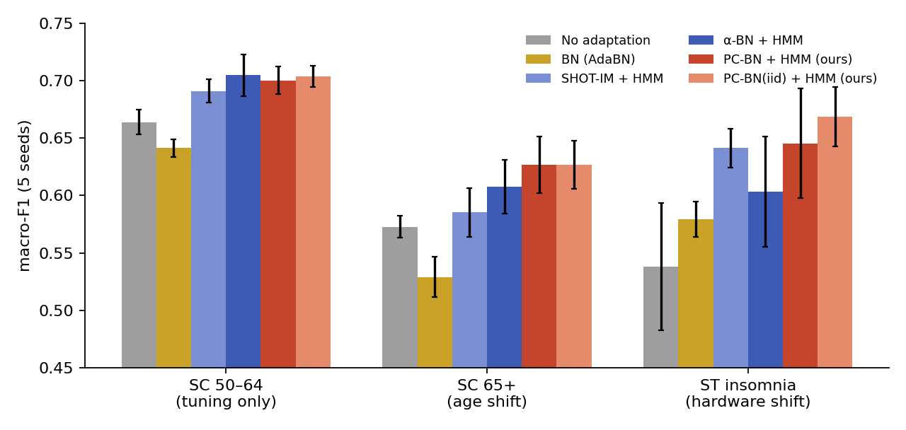

# Prior-Corrected Test-Time Normalization for Sleep Staging under Population Shift

*Write-up, 3 Nov 2026. All numbers come from `outputs/sleep_summary.md` (5 source seeds, after
the audit fixes listed at the end). Reproduce with the commands at the end.*

## 1. Problem

A sleep-staging model is trained on one group of people and then used on someone new. At test
time we receive one unlabeled night and must score its 30-second epochs (W, N1, N2, N3, REM)
without any labels from that person. This is *test-time adaptation* (TTA) at the level of a
single night.

The shift between training and test nights comes in two kinds, and in real data they arrive
together:

* **covariate shift:** the EEG itself looks different (other hardware, electrode impedance,
  amplitude), and
* **label shift:** the person's stage mix is different. Elderly sleepers have far less deep
  sleep and much more wake:

| stage share (%) | W | N1 | N2 | N3 | REM |
|---|---|---|---|---|---|
| source (SC, age 25–34) | 19.6 | 6.6 | 42.1 | 13.5 | 18.2 |
| SC 50–64 | 34.0 | 10.3 | 37.5 | 5.2 | 13.1 |
| SC 65+ | 40.3 | 13.3 | 31.6 | 4.3 | 10.4 |
| ST insomnia (telemetry) | 11.3 | 9.6 | 44.8 | 14.8 | 19.5 |

So SC 65+ is mostly a **label shift**, and ST (other hardware, a stage mix close to the
source) is mostly a **covariate shift**.

## 2. Key observation: night-level BatchNorm confuses the two shifts

The most common TTA step is to recompute BatchNorm statistics on the test data (AdaBN /
"test-time BN"), and almost every TTA method (TENT, SHOT, ...) builds on it. A night's BN
statistics, however, are a *mixture over stages*:

  mean_night = Σ_c π_night(c) · μ_c

so a night with little N3 has different statistics even when the recording is perfect.
Normalising with them removes the stage-mix difference along with the hardware difference.

On Sleep-EDF this is not a corner case (pooled macro-F1):

| target | no adaptation | BN (AdaBN) | Δ | N3 F1: none → BN |
|---|---|---|---|---|
| SC 65+ (mostly label shift) | 0.573 | **0.529** | −4.4 | 0.660 → 0.516 |
| ST insomnia (mostly covariate shift) | 0.538 | **0.580** | +4.2 | 0.710 → 0.597 |

On the elderly, **every BN-based TTA method that predicts epoch by epoch is worse than doing
nothing**: TENT 0.527, SHOT-IM 0.534, entropy + prior 0.521, HMM-teacher 0.547. Adding an HMM
decoder only brings them back to about the no-adaptation level (BN + HMM 0.579, SHOT-IM + HMM
0.585).

## 3. Method

### 3.1 Prior-corrected BN (PC-BN)

The source model's running statistics were accumulated under the source stage mix π_src. To
remove only the label-shift part, we estimate *per-stage* statistics on the night and
recombine them with the source mix:

1. Soft stage labels r_tc for the night: recompute night BN, predict, and smooth the
   predictions with an HMM that uses the source transition matrix (§3.2). The `iid` variant
   skips the smoothing.
2. For each BN layer in order (each layer's input depends on the layers before it), compute
   per-epoch channel means m_t and second moments s_t, then

   μ_c = (Σ_t r_tc m_t + τ m̄) / (Σ_t r_tc + τ),  same for s_c   (τ shrinks rare stages)

   μ = Σ_c π_src(c) μ_c,  σ² = Σ_c π_src(c) s_c − μ²

3. Repeat steps 1–2 (`rounds` = 2; τ = 20 pseudo-epochs, both chosen on SC 50–64).

There are no gradient steps, no extra parameters and no source data, only π_src and the
source transition counts, both saved with the model.

### 3.2 Decoding with the source transition prior

The CNN scores epochs independently. Dividing its posterior by π_src gives a scaled
likelihood, and a forward–backward pass with the source stage-transition matrix turns these
into smoothed posteriors (`hmm_src`). Using a transition prior at test time is not new (see
OATTA in §7). We use it as a component and show that PC-BN combines with it better than the
alternatives do.

## 4. Setup

* **Data:** Sleep-EDF Expanded, Fpz-Cz EEG at 100 Hz, 30 s epochs, AASM stages (R&K 3+4 → N3),
  30 min of wake kept around the sleep period. 139 nights.
* **Source:** SC subjects aged 25–34 (20 people, 39 nights). Split by subject 14/3/3 for
  train/val/test, with a different split for each of the 5 seeds. No subject appears in two
  parts or in a target (checked).
* **Targets** (each night adapted separately, model reset between nights):
  * SC 50–64: 43 nights, **used only for choosing hyper-parameters**
  * SC 65+: 35 nights, held out
  * ST placebo nights: 22 nights, insomnia patients on hospital telemetry hardware, held out
* **Model:** a 1D CNN with BatchNorm (332k parameters) that sees one epoch at a time (no
  context), so every temporal effect comes from the TTA method.
* **Baselines** (all on top of night BN; gradient methods update the BN affine parameters):
  TENT, SHOT-IM, entropy + source-prior matching, α-BN (mix of source and night statistics),
  TRIBE-style balanced BN (uniform class weights), EM prior correction (Saerens et al.), and
  HMM decoders.
* **Protocol:** one shared grid per method, tuned on SC 50–64 with seed 0. The grids are lr ×
  steps for gradient methods, τ × rounds for the balanced-BN variants, and α ∈ {.25,.5,.75}
  for α-BN (α = 0.5 chosen). Settings are then frozen. Metrics are pooled macro-F1 (headline),
  per-night macro-F1, Cohen's κ, and per-stage F1. Paired Wilcoxon tests run over nights, on
  per-night macro-F1 averaged over seeds.

## 5. Results



Pooled macro-F1, mean of 5 seeds (± std in `outputs/sleep_summary.md`):

| method | SC 50–64 (tuning) | SC 65+ | ST | held-out mean |
|---|---|---|---|---|
| no adaptation | 0.664 | 0.573 | 0.538 | 0.555 |
| BN (AdaBN) | 0.641 | 0.529 | 0.580 | 0.554 |
| TENT | 0.641 | 0.527 | 0.583 | 0.555 |
| SHOT-IM | 0.639 | 0.534 | 0.579 | 0.556 |
| uniform balanced BN (TRIBE-style) | 0.665 | 0.562 | 0.589 | 0.575 |
| α-BN | 0.677 | 0.599 | 0.597 | 0.598 |
| **PC-BN** | 0.675 | 0.593 | 0.602 | 0.597 |
| BN + HMM | 0.690 | 0.579 | 0.633 | 0.606 |
| TENT + HMM | 0.691 | 0.572 | 0.647 | 0.610 |
| SHOT-IM + HMM | 0.691 | 0.585 | 0.641 | 0.613 |
| α-BN + HMM | **0.705** | 0.608 | 0.604 | 0.606 |
| **PC-BN + HMM** | 0.700 | **0.627** | 0.645 | 0.636 |
| **PC-BN(iid) + HMM** | 0.704 | **0.627** | **0.668** | **0.648** |

Paired tests (per-night macro-F1, difference in points, p from Wilcoxon):

| comparison | SC 50–64 | SC 65+ | ST |
|---|---|---|---|
| PC-BN vs BN | +3.1, p=6e-9 | **+6.0, p=2e-8** | +2.1, p=0.21 |
| PC-BN vs no adaptation | +3.4, p=0.015 | +3.2, p=0.084 | +6.1, p=0.023 |
| PC-BN + HMM vs no adaptation | +5.6, p=5e-5 | **+5.6, p=4e-4** | +9.5, p=0.021 |
| PC-BN vs uniform-weight balanced BN (TRIBE-style) | +1.2, p=5e-4 | **+2.8, p=5e-7** | +0.8, p=0.34 |
| PC-BN vs PC-BN(iid) (does temporal labelling help?) | +0.4, p=0.002 | +1.3, p=3e-7 | −1.1, p=0.26 |
| PC-BN vs α-BN | +0.9, p=0.49 | +0.7, p=0.49 | +0.8, p=0.54 |
| PC-BN + HMM vs BN + HMM | +0.8, p=0.59 | **+4.6, p=9e-6** | +1.0, p=0.82 |
| PC-BN + HMM vs α-BN + HMM | +0.4, p=0.69 | **+3.1, p=0.014** | +3.9, p=0.11 |
| PC-BN(iid) + HMM vs α-BN + HMM | +1.0, p=0.91 | **+3.6, p=0.010** | **+6.7, p=0.009** |

**What the evidence supports**

1. Night-level BN, and every TTA method built on it, fails under natural age-related label
   shift in sleep staging. On the elderly, all of them are below no adaptation when predicting
   epoch by epoch (BN −4.4 pooled macro-F1, N3 F1 0.66 → 0.52). On the hardware shift (ST),
   the same BN step helps (+4.2).
2. Re-weighting per-stage statistics to the **source** prior removes most of that damage:
   PC-BN beats BN by 6.0 per-night points on the elderly (33 of 35 nights) without losing
   the gain on ST. Weighting by π_src is clearly better than uniform weighting (TRIBE-style,
   the existing "balanced BN" recipe) on both SC targets.
3. On its own, PC-BN is statistically tied with a tuned α-BN, and its gain over no adaptation
   on the elderly (+3.2) is not significant (p = 0.084). Its advantage shows up when it is
   combined with the temporal decoder. On the two held-out targets PC-BN gains 3.4–4.3 pooled
   points from the HMM, while α-BN gains only 0.7–0.9 (on SC 50–64 both gain about 2.5–2.8).
   PC-BN + HMM is significantly better than no adaptation on all three targets, and better
   than α-BN + HMM on the elderly (both variants) and on ST (iid variant).
4. Best overall pipeline: PC-BN + source-transition HMM, held-out pooled macro-F1 0.636–0.648,
   against 0.555 for no adaptation and 0.613 for the best gradient-based TTA (SHOT-IM + HMM).

**Caveat on variant choice.** PC-BN with temporal soft labels was the pre-specified method.
The `iid` variant was an ablation and turned out as good or better after decoding,
especially on ST. Declaring it "the" method would be a choice made after seeing the held-out
results, so both are reported. A new study should pre-register the simpler `iid` variant.

## 6. What did *not* work (kept for honesty and as negative results)

| idea | result |
|---|---|
| **Jump-chain loss** (match the source "where does a stage go when it ends" matrix; dwell-invariant) | +0.4–1.1 per-night points over BN with argmax (significant on SC 50–64 and ST, not on SC 65+); *worse* than BN once the HMM decoder is added |
| **Dwell-only HMM re-fitting** (re-estimate only how long stages last) | worse than the fixed source HMM on all three targets (p ≤ 1e-4) |
| **HMM-teacher self-training** (train BN params on HMM-smoothed pseudo-labels) | +0.7–1.4 over BN, but always worse than simply decoding BN's predictions with the HMM (p ≤ 0.005) |
| EM prior correction (Saerens) | hurts everywhere (overconfident posteriors under shift) |
| Premise check (`study_dwell.py`) | dwell changes carry 44–69% of the shift in stage dynamics. The whole dynamics shift is tiny (~0.01 nats/transition), so the *source* transition matrix transfers almost perfectly. This is why the fixed HMM beats every re-fitted one. |

## 7. Related work and novelty

* **AdaBN / test-time BN; TENT; SHOT:** the baselines here. Their failure under label shift is
  known in vision (DELTA; TRIBE; UnMix-TNS; channel-selective normalization for label-shift
  robust TTA, arXiv 2402.04958). We show it on a *natural* clinical label shift in sleep
  staging.
* **TRIBE balanced BN** (arXiv 2309.14949): per-class statistics averaged *uniformly*. PC-BN
  weights them by the source prior, which is what the source running statistics actually were.
  It is significantly better here on the label-shift targets.
* **α-BN / TTN:** interpolate source and test statistics. Tied with PC-BN alone, but they
  combine less well with temporal decoding.
* **OATTA** (arXiv 2601.21012): gradient-free transition-matrix prior for streaming TTA. Our
  `hmm_src` decoder is the same idea and is used as a component, not claimed.
* **Sleep-specific TTA:** StableSleep (arXiv 2509.02982, TENT + BN refresh on Sleep-EDF),
  PSDNorm (arXiv 2503.04582), SPDIM (arXiv 2411.07249, label shift in EEG via SPD manifolds).

**Claimed contribution (modest):** (i) the diagnosis that night-level BN conflates label and
covariate shift in sleep staging and makes BN-based TTA worse than no adaptation on elderly
sleepers; (ii) source-prior-weighted per-stage BN statistics as a simple, gradient-free fix,
better than uniform balancing; (iii) the finding that this normalization combines with
transition-prior decoding better than α-BN does.

## 8. Limitations and next steps

* One dataset and 5 seeds; ST has only 22 nights. PC-BN + HMM on ST has high seed variance
  (± 0.048; seeds 0 and 3 are low), while the `iid` variant is stable (± 0.026).
* PC-BN alone does not significantly beat no adaptation on the elderly; the significant gain
  needs the HMM decoder.
* Single-epoch CNN. Sequence models such as DeepSleepNet or AttnSleep may already absorb part
  of the temporal gain.
* N3 is still not fully recovered on the elderly (F1 0.55–0.58 vs 0.66 without adaptation),
  even though macro-F1 improves.
* Hyper-parameter grids are small. The gradient baselines chose the smallest lr and step
  count in the grid, which means they want to stay close to BN.
* Offline per night (the whole night is available before scoring). An online/streaming
  variant is future work.
* **To make it publishable:** add a second, larger cohort with a real age range (SHHS or MASS,
  which need data-access applications), a sequence backbone, an online variant, and
  pre-registration of the `iid` variant.

## Audit (3 Nov 2026)

A full check before the final write-up found and fixed four problems; every TTA result above
comes from the re-run after the fixes (old outputs kept in `outputs/old_before_fix/`):

1. **Dropout was on while night BN statistics were collected** (`night_bn` put the whole model
   in train mode). Only BN layers go to train mode now. BN-based baselines got better (e.g. BN
   on SC 65+ 0.505 → 0.529); PC-BN numbers barely moved, since its statistics are recomputed.
2. **Per-night macro-F1 counted stages absent from a night** as F1 = 0. It now uses only stages
   present in the night or its prediction.
3. **The balanced-BN grid was silently skipped** when tuning ran from scratch (`tune` had
   already filled default settings). Fixed. For PC-BN and PC-BN(iid) the grid picks τ = 20,
   rounds = 2, the values used. The uniform balanced-BN baseline picks 4 rounds and was re-run
   with it (`outputs/sleep_bal_s*.json`).
4. **`summarize_sleep.py` merged result files in alphabetical order**, so a re-run of some
   methods could be overwritten by the main run. Fixed; the main run is read first.

Data checks: no subject overlap between source train/val/test and the targets; splits are
reproducible from the seed; source models were not affected (dropout is meant to be on in
training).

## Reproduce

```bash
pip install -r requirements.txt
python -m data.sleepedf --cache data/sleep_cache              # ~6 GB download, ~1 GB kept
for s in 0 1 2 3 4; do python train_sleep.py --seed $s; done
python study_dwell.py                                          # premise check
bash run_sleep_all.sh                                          # tuning + 5 seeds + tables + figure (~2 h)
```
